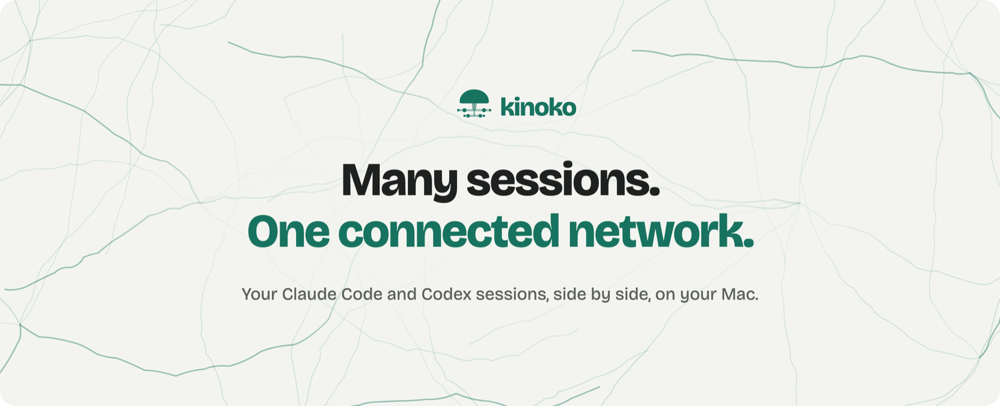
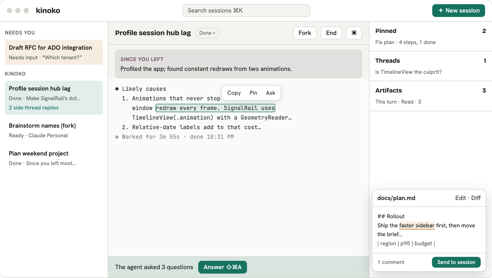

<picture>
  <source media="(prefers-color-scheme: dark)" srcset="assets/hero-dark.png">
  
</picture>

# kinoko

kinoko is a Mac app that runs your Claude Code and Codex sessions side by side. It doesn't replace them: it runs the real command-line tools with your own logins, and connects the sessions. Everything runs on your Mac. There are no API keys to paste, and nothing is written to your agent settings.

<picture>
  <source media="(prefers-color-scheme: dark)" srcset="assets/ui-dark.png">
  
</picture>

## What it does

- **All your sessions in one window.** Claude Code and Codex, each with its own profile (for example, work and personal), in a sidebar that shows which ones need you.
- **Since you left.** Come back to a short summary of what a session did while you were away.
- **Side threads.** Ask a side question about any reply or selected passage without interrupting the main session.
- **Answer the agent's questions in a form.** When the agent asks several things at once, answer them one by one and send them back together.
- **Pins.** Keep a plan, checklist or passage in view. Tick items off as the work moves.
- **Artifacts and review.** Every file a session writes shows up next to it, rendered. Comment on a passage or edit it in place, then send your comments to the session in one go.
- **Fork.** Branch a session into a new one that carries the context forward.

This repository holds kinoko's releases and its Homebrew cask. The app's source isn't public.

## Install

**Download:** [Kinoko.dmg](https://github.com/alextacho/kinoko/releases/latest/download/Kinoko.dmg), then drag kinoko to Applications.

**Homebrew:**

```bash
brew tap alextacho/kinoko https://github.com/alextacho/kinoko
brew install --cask kinoko
```

Update with `brew upgrade --cask kinoko`.

Requires macOS 14 (Sonoma) or later on Apple silicon.

## First launch

Early builds aren't notarized by Apple yet, so macOS blocks the first launch of a downloaded copy with "Apple could not verify Kinoko is free of malware". To open it:

1. Open kinoko once and dismiss the warning.
2. Go to **System Settings → Privacy & Security**, scroll down, and click **Open Anyway**.

The Homebrew install doesn't show this warning.

## Feedback

Found a bug or have an idea? [Open an issue](https://github.com/alextacho/kinoko/issues), or email alex@alextacho.com.

## Releases

Each version is listed under [Releases](https://github.com/alextacho/kinoko/releases) with its notes.
